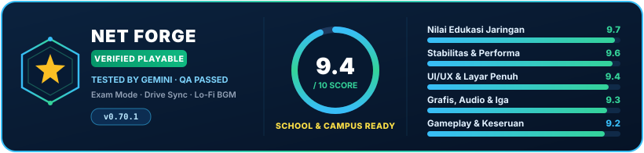

# NET FORGE

  

  
  
  
  

 

NET FORGE adalah game simulasi dan pembelajaran jaringan komputer: bangun topologi, hubungkan perangkat, konfigurasi IP/DHCP/routing, lalu selesaikan misi.

- Live PWA: https://igoon.github.io/NetForge/
- Rilis saat ini: v0.69.1
- Backend: Google Login, progres, leaderboard, dan validasi misi terpadu

## Lisensi

Kode sumber dan materi dalam repositori ini dilisensikan di bawah **Apache License 2.0**. Lihat [LICENSE](LICENSE) untuk teks lisensi lengkap dan [NOTICE](NOTICE) untuk atribusi.

Aset, pustaka, nama produk, standar, dan komponen pihak ketiga tetap tunduk pada hak dan lisensi masing-masing. Apache License 2.0 tidak memberikan izin penggunaan merek dagang atau nama proyek di luar penggunaan wajar untuk menjelaskan asal karya.
